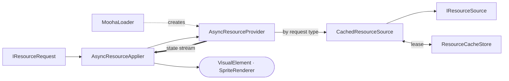

# Mooha

Async resource loading for Unity. A load is stated as a typed **request**, served by a **source**
registered for that request type, and delivered as a stream of states — placeholder, then the
resource or a default — that an **applier** pushes into a widget. Released resources stay in a
shared LRU cache, so a screen the user walks back into does not reload.

The shape follows Glide/Coil: `MoohaLoader` ≈ `ImageLoader`, `IResourceSource` ≈ `ModelLoader`,
`ResourceCacheStore` ≈ the memory cache tier a dropped reference demotes into.

Install and requirements: [repository README](https://github.com/95D/MoohaDev#readme).

## Structure



Every other type is a detail of one of these stages.

## Roles

| Class | Namespace | Role |
|---|---|---|
| `MoohaLoader` | `Headwind.Mooha` | Entry point; holds the sources and fallbacks registered per resource type. |
| `IResourceRequest` | `.Request` | Names what to load, pins the resource type, carries the cache key. |
| `AsyncResourceProvider` | `.Provider` | Turns one request into a stream of states. |
| `ResourceLoadResult` · `ResourceLoadState` | `.Result` | One emission, and the handle the receiver now owns. |
| `ResourceSourceRegistry` | `.Source` | Picks the source by the request's runtime type. |
| `CachedResourceSource` | `.Source` | Cache decorator over any source. |
| `AddressableSpriteAtlasSource` · `AtlasSpriteSource` · `AddressableSpriteSource` · `AddressableTextureSource` | `.Source` | The Addressables backends; `AtlasSpriteSource` composes the atlas source. |
| `AsyncResourceApplier` | `.Applier` | Pushes each result into one widget and owns the handle it shows. |
| `ResourceCacheStore` | `.Cache` | Lease-based LRU; one byte budget shared by every resource type. |
| `ResourceSizeTable` | `.Size` | Editor-baked byte sizes, for resources that cannot report their own. |
| `ResourceHandle` · `ResourceRef` | `.Model` | A resource with its release and cost; a fallback as value or request. |
| `ResourceSizeTableBaker` · `IResourceSizeCalculator` | `.Editor.*` | Editor only: measures Addressable entries and writes the table. |

## Usage

Register one source per request type and the fallbacks per resource type at startup:

```csharp
using Headwind.Mooha;
using Headwind.Mooha.Cache;
using Headwind.Mooha.Request;
using Headwind.Mooha.Source;

var cache = new ResourceCacheStore(ResourceCacheBudget.FromDeviceMemory());

var atlasSource = new CachedResourceSource<AddressableSpriteAtlasRequest, SpriteAtlas>(
    new AddressableSpriteAtlasSource(sizeTable),
    cache
);
MoohaLoader.RegisterSource(atlasSource);
MoohaLoader.RegisterSource(
    new CachedResourceSource<AtlasSpriteRequest, Sprite>(new AtlasSpriteSource(atlasSource), cache)
);
MoohaLoader.SetDefaults<Sprite>(placeholder: placeholderSprite, defaultResource: missingSprite);
```

Share one `ResourceCacheStore` across every source; a per-type cache strands free space.

Then load wherever a widget needs a resource:

```csharp
using Headwind.Mooha;
using Headwind.Mooha.Applier;
using Headwind.Mooha.Request;

var provider = MoohaLoader.CreateProvider<Sprite>();
var applier = new VisualElementSpriteApplier(provider, element);
applier.Load(new AtlasSpriteRequest("icons/items", "sword"));
```

An applier owns the handle it is showing, so dispose it — or call `Cancel()` — when the widget goes
away. `Load()` replaces an in-flight load, so it is safe to call on every rebind.

### Size table

A sprite atlas cannot report its own memory cost at runtime, so the cost is measured in the editor
and baked into a `ResourceSizeTable` asset that the runtime only reads.

1. Create exactly one table via **Assets > Create > Mooha > Resource Size Table** and pass it to
   `AddressableSpriteAtlasSource`.
2. The bake runs on build, on play mode entry, on build target switches, and on demand from
   **Tools > Mooha > Bake Resource Size Table** — per target, because texture bytes move with
   compression format and max size overrides.

Implement `IResourceSizeCalculator` to measure your own asset types; it is discovered by type scan,
with no registration asset. An address missing from the table is passed through uncached rather than
estimated.
